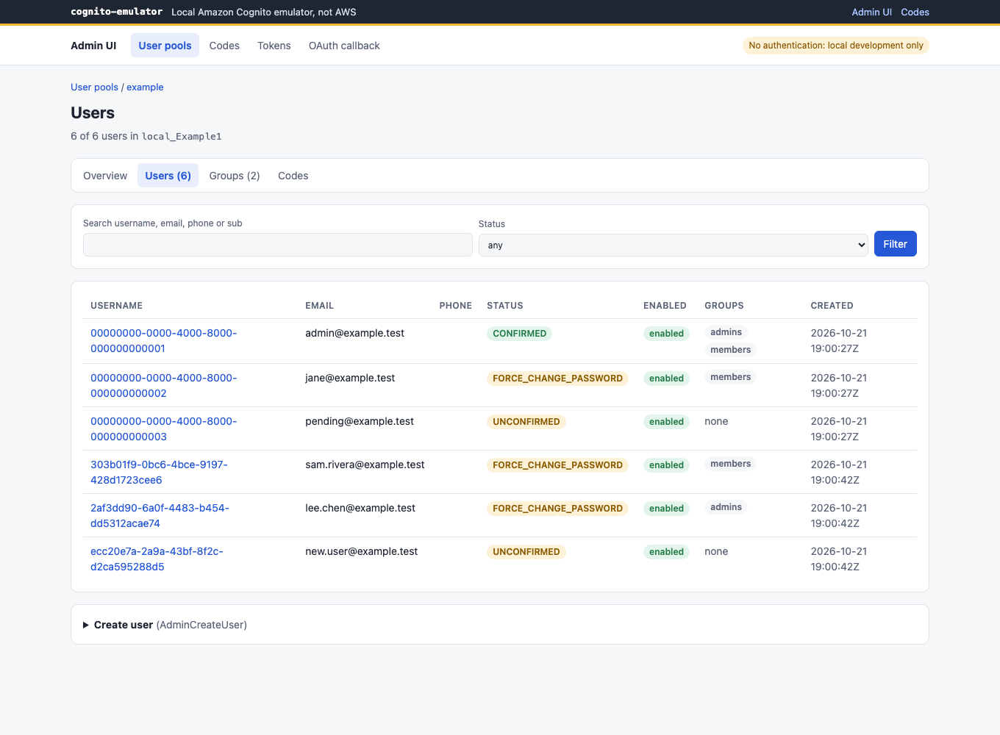
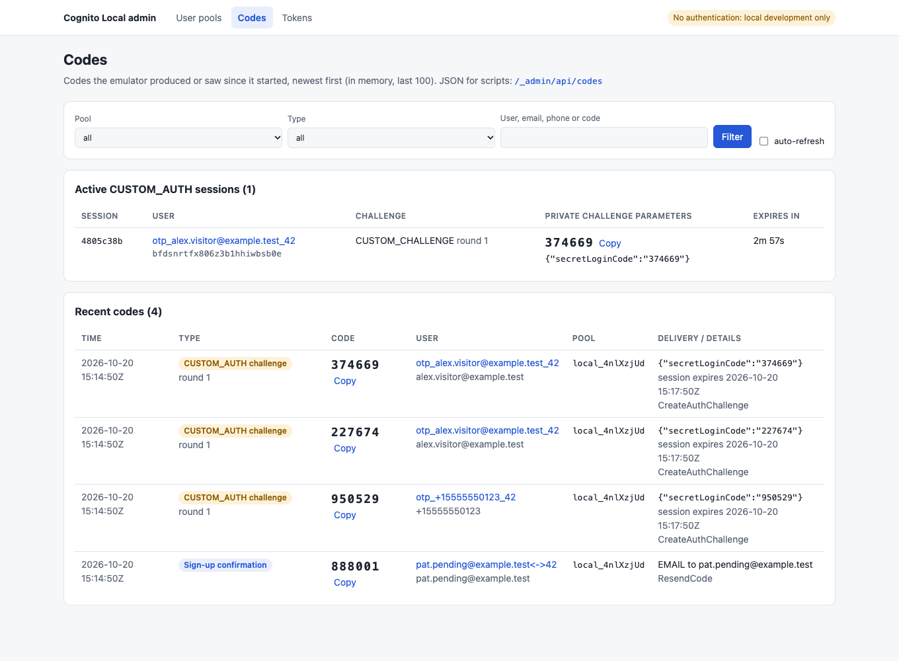
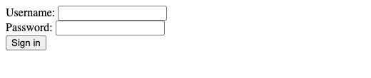
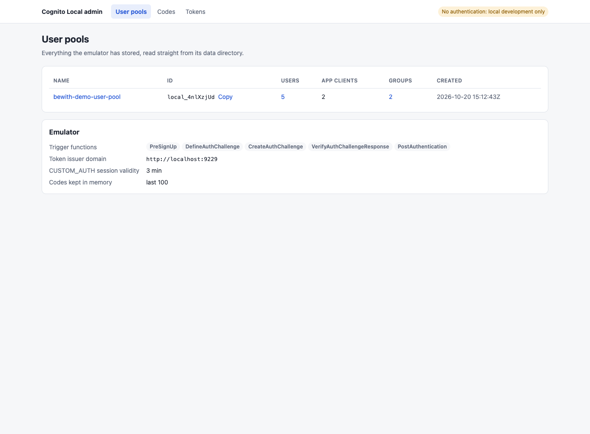
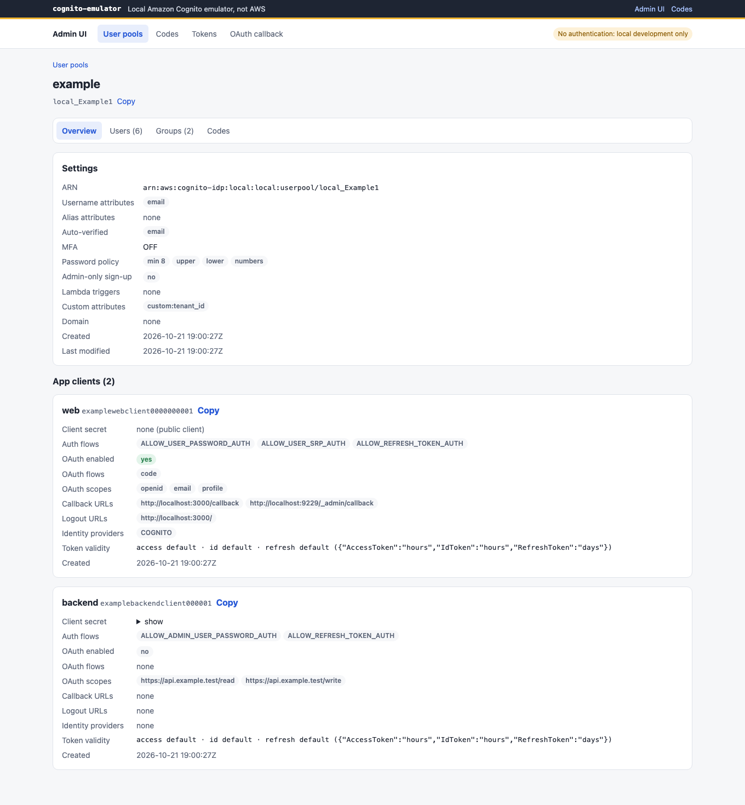
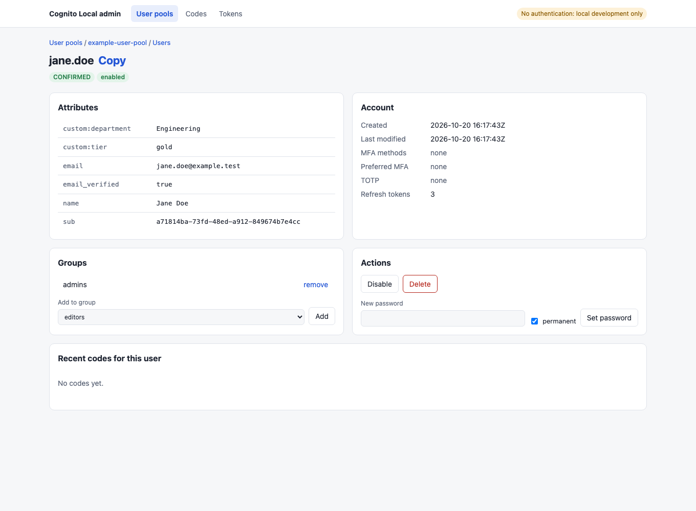
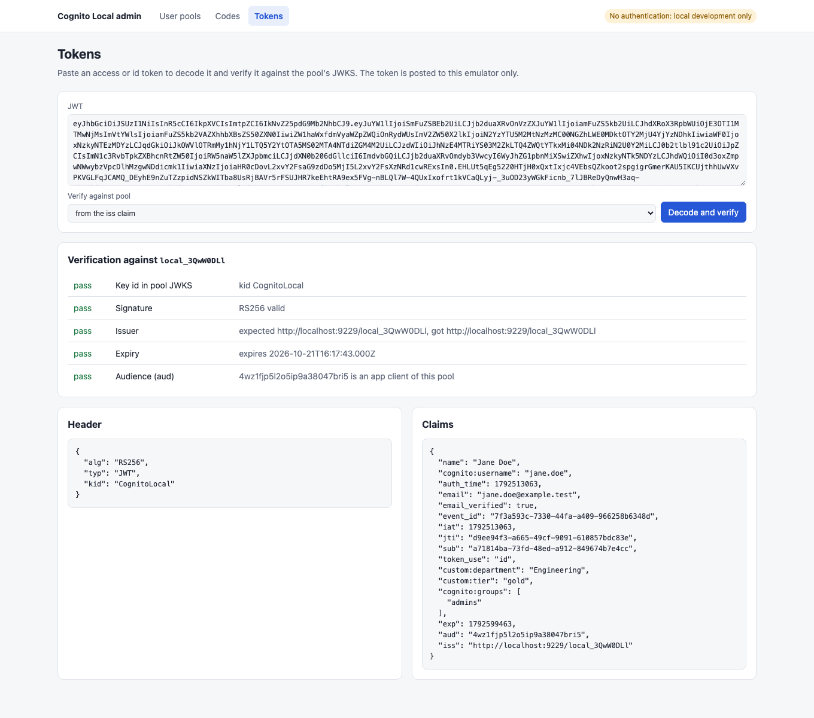

<div align="center">

# cognito-emulator

**A local emulator of the Amazon Cognito User Pools API, for development and tests.**

[](https://github.com/relbns/cognito-local/actions/workflows/main.yml)
[](https://github.com/relbns/cognito-local/actions/workflows/docker.yml)
[](https://github.com/relbns/cognito-local/pkgs/container/cognito-local)
[](docs/sdk-compatibility.md)
[](#install)
[](LICENSE)
<!-- Add once the package is on the npm registry:
[](https://www.npmjs.com/package/cognito-emulator)
-->

[Install](#install) · [Quick start](#quick-start) · [Recipes](#recipes) · [Configuration](#configuration-reference) · [Compatibility](#compatibility-and-differences-from-aws) · [Troubleshooting](#troubleshooting)

</div>

Point an AWS SDK, the AWS CLI or a browser at `http://localhost:9229` and sign-up, sign-in, groups,
admin operations and the OAuth2 endpoints work without an AWS account. It is a fork of
[jagregory/cognito-local](https://github.com/jagregory/cognito-local) that adds stateful CUSTOM_AUTH
(passwordless) challenges, Cognito-compatible hosted login, a mock federated identity provider, token
checks as Cognito makes them, an admin UI with a codes viewer, seed files, local trigger files, a CLI
and a Docker image. It is not AWS: it mimics the observable behaviour closely enough for development
and tests, and [the differences](#compatibility-and-differences-from-aws) are listed below.

## Features

- **Your AWS clients, unchanged.** The AWS SDK for JavaScript, boto3 and the AWS CLI v2 read the
  endpoint from `AWS_ENDPOINT_URL_COGNITO_IDENTITY_PROVIDER`. The emulator answers 122 API operations.
- **Passwordless CUSTOM_AUTH.** Define, Create and Verify challenge triggers run from local JavaScript
  files with the event Lambda would get, and the session keeps its state between challenges.
- **Hosted login and OAuth2.** `/oauth2/authorize`, `/oauth2/token`, `/oauth2/userInfo`,
  `/oauth2/revoke`, `/logout` and OIDC discovery, with PKCE and a callback page to try them. The
  login page has sign-up, confirm, forgot-password and MFA setup pages.
- **Passkeys.** WebAuthn registration and `WEB_AUTHN` sign-in in `USER_AUTH`, with the attestation,
  signature, origin and relying party checked as Cognito checks them, and passkey buttons on the
  hosted login page and `/passkeys/add`. Tests can use a software authenticator, no browser needed.
- **Federated sign-in without a provider.** A mock IdP page stands in for social, OIDC and SAML
  providers, with attribute mapping and linked users.
- **Tokens checked as Cognito checks them.** Signature, issuer, expiry, user and revocation of access
  and refresh tokens, and `SECRET_HASH`. A `config.json` switch restores the lenient behaviour.
- **Admin UI with a codes viewer.** Pools, clients, users, groups, a token decoder, and the recent
  sign-up, forgot-password, MFA, temporary-password and CUSTOM_AUTH codes, so no real inbox is needed.
- **Seed files and export.** Pools, clients, groups and users in a JSON file with AWS API field names,
  applied idempotently at startup or into a running server.
- **Built for CI.** `status`, `seed`, `export` and `reset` commands with JSON output and fixed exit
  codes, and a multi-arch Docker image with a health check.

<p align="center">
  
</p>

## Install

Requires **Node.js 20 or later** (`engines: >=20`). Node.js 22 is recommended: the Docker image uses
it, and the AWS SDK v3 that the emulator runs on requires 22 for releases from January 2027.

> [!NOTE]
> The npm package is `cognito-emulator`. Its npm release is coming: once it is published,
> `npx cognito-emulator start` and `npm install -g cognito-emulator` install it from the registry.
> Until then, install it from GitHub: the GitHub and Docker commands below work today.

The package installs two commands that run the same program, `cognito-emulator` and `cognito-local`.
This README uses `cognito-local`.

| Way                           | Command                                                                              |
| ----------------------------- | ------------------------------------------------------------------------------------ |
| npx, nothing installed        | `npx github:relbns/cognito-local start`                                              |
| Global command                | see [Global install](#global-install)                                                |
| Dev dependency of a project   | `npm install --save-dev github:relbns/cognito-local`, then `npx cognito-local start` |
| Docker                        | `docker run --rm -p 127.0.0.1:9229:9229 ghcr.io/relbns/cognito-local:edge`           |
| From source                   | `git clone`, `npm install`, `npm start`                                              |
| npm registry (once published) | `npx cognito-emulator start`, or `npm install -g cognito-emulator`                   |

Every way starts the server on `http://localhost:9229` with the admin UI at `/_admin` and its data in
`./.cognito` (`/app/.cognito` in the image).

### npx

```bash
npx github:relbns/cognito-local start
```

The first run clones the repository, installs its dev dependencies and builds it (about 30 seconds).
Later runs start at once from the npx cache. Pin a version with `#<tag, branch or sha>`:
`npx github:relbns/cognito-local#1c078ef start`. If npx keeps running an older build after `main`
moved, clear its cache with `rm -rf ~/.npm/_npx`.

### Global install

`npm install -g github:relbns/cognito-local` does not work with npm 10: npm runs the package's build
step in global mode, the dev dependencies are not installed, and it fails with
`sh: tsc: command not found`. Build a tarball first and install that:

```bash
cd "$(mktemp -d)"
npm install -g "$(npm pack github:relbns/cognito-local | tail -1)"
cognito-local start
```

Remove it with `npm uninstall -g cognito-emulator`.

### Docker

Multi-arch images (`linux/amd64`, `linux/arm64`) are on GitHub Container Registry. `edge` follows
`main`. `latest` and `X.Y.Z` / `X.Y` / `X` are published when a `v*` tag is pushed; no release of the
fork has been tagged yet, so use `edge`.

```bash
docker run --rm -p 127.0.0.1:9229:9229 \
  -v cognito-data:/app/.cognito \
  -v "$PWD/seed.basic.json:/seed.json:ro" \
  ghcr.io/relbns/cognito-local:edge --seed /seed.json
```

- The image runs `cognito-local start`, so arguments after the image name are `start` flags
  (`--seed`, `--no-admin`). Environment variables work too (`COGNITO_LOCAL_SEED=/seed.json`).
- It listens on `0.0.0.0:9229` inside the container as the unprivileged `node` user, keeps data and
  `config.json` in the `/app/.cognito` volume, and has a health check on `/health`.
- `-p 127.0.0.1:9229:9229` keeps the port, and the admin UI, off your network. Inside the container
  the server listens on `0.0.0.0`, so it prints a warning until `COGNITO_LOCAL_ADMIN_TOKEN` is set.
- Tokens are issued for `http://localhost:9229`. When clients reach the emulator under another name,
  set `TokenConfig.IssuerDomain` to that URL (see [Docker Compose](#docker-compose)).
- To apply a seed to a running container, run `cognito-local seed seed.json --url http://localhost:9229`
  on the host, or `curl -X POST -H 'Content-Type: application/json' --data-binary @seed.json http://localhost:9229/_admin/api/seed`.

### Docker Compose

```yaml
services:
  cognito:
    image: ghcr.io/relbns/cognito-local:edge
    command: ["--seed", "/seed/seed.json"]
    ports:
      - "127.0.0.1:9229:9229"
    volumes:
      - cognito-data:/app/.cognito
      - ./cognito/config.json:/app/.cognito/config.json
      - ./cognito/seed.json:/seed/seed.json:ro

  app:
    image: your-app
    environment:
      AWS_ENDPOINT_URL_COGNITO_IDENTITY_PROVIDER: http://cognito:9229
      AWS_ACCESS_KEY_ID: local
      AWS_SECRET_ACCESS_KEY: local
      AWS_REGION: us-east-1
    depends_on:
      cognito:
        condition: service_healthy

volumes:
  cognito-data:
```

with `cognito/config.json`:

```json
{ "TokenConfig": { "IssuerDomain": "http://cognito:9229" } }
```

- Other containers reach the emulator as `http://cognito:9229`. The issuer is part of every token
  (`iss`) and of the OIDC discovery document, so set `IssuerDomain` to the URL the code that
  verifies tokens uses. Use `http://localhost:9229` instead when only the host and browsers talk to it.
- The emulator rewrites `config.json` when it starts, so mount it read-write; a `:ro` mount stops it
  with `EROFS: read-only file system`.
- When a seed uses `file:` triggers, mount the seed's whole directory (for example `./cognito:/seed:ro`):
  trigger paths are resolved against the seed file.

### From source

```bash
git clone https://github.com/relbns/cognito-local.git
cd cognito-local
npm install    # also builds lib/
npm start      # runs src/ with tsx; flags go after --, e.g. npm start -- --port 9330
```

`node lib/bin/cli.js start` runs the build, `npm run cli -- <command>` the TypeScript source, and
`node lib/bin/start.js` is the same as `cognito-local start`.

## Quick start

The commands below use npx. With a global install write `cognito-local`; from a clone,
`node lib/bin/cli.js` and `examples/seed.basic.json`.

### 1. Start with the example seed

```bash
curl -fsSLO https://raw.githubusercontent.com/relbns/cognito-local/main/examples/seed.basic.json
npx github:relbns/cognito-local start --seed seed.basic.json
```

[`seed.basic.json`](examples/seed.basic.json) creates the pool `local_Example1` (email as username,
a password policy, a custom attribute), a public client `examplewebclient0000000001` (password
sign-in and hosted login), a confidential client `examplebackendclient000001` (with a secret), the
groups `admins` and `members`, and three users: `admin@example.test` with password `Passw0rdAdmin`,
`jane@example.test` with a temporary password, and the unconfirmed `pending@example.test`.

### 2. Open the admin UI

Open <http://localhost:9229/_admin>: pools, clients, users, groups, codes and a token decoder. It is
open by default; keep it on your machine, or set an [admin token](#admin-token). More pages are under
[Screenshots](#screenshots).

### 3. Point your tools at it

In another terminal:

```bash
export AWS_ENDPOINT_URL_COGNITO_IDENTITY_PROVIDER=http://localhost:9229
export AWS_ACCESS_KEY_ID=local AWS_SECRET_ACCESS_KEY=local
export AWS_REGION=us-east-1 AWS_DEFAULT_REGION=us-east-1
```

The AWS SDK for JavaScript v3, boto3 and the AWS CLI v2 read the endpoint from
`AWS_ENDPOINT_URL_COGNITO_IDENTITY_PROVIDER`, so application code needs no change. Credentials and
region must be set but are not checked. boto3 reads `AWS_DEFAULT_REGION`, not `AWS_REGION`.

### 4. Sign up, confirm with the code, sign in

With the AWS CLI and `jq`:

```bash
aws cognito-idp sign-up --client-id examplewebclient0000000001 \
  --username new@example.test --password 'Passw0rdNew' \
  --user-attributes Name=email,Value=new@example.test
```

The confirmation code is not emailed; it is on the **Codes** page (<http://localhost:9229/_admin/codes>),
in the server log, and in the codes feed:

```bash
CODE=$(curl -s 'http://localhost:9229/_admin/api/codes?q=new@example.test&type=SIGN_UP&limit=1' | jq -r '.codes[0].code')
aws cognito-idp confirm-sign-up --client-id examplewebclient0000000001 \
  --username new@example.test --confirmation-code "$CODE"
aws cognito-idp initiate-auth --client-id examplewebclient0000000001 \
  --auth-flow USER_PASSWORD_AUTH \
  --auth-parameters USERNAME=new@example.test,PASSWORD='Passw0rdNew'
```

<p align="center">
  
</p>

### 5. The same from code

JavaScript (AWS SDK v3, `npm install @aws-sdk/client-cognito-identity-provider`):

```js
import {
  CognitoIdentityProviderClient,
  InitiateAuthCommand,
} from "@aws-sdk/client-cognito-identity-provider";

const client = new CognitoIdentityProviderClient({});
const { AuthenticationResult } = await client.send(
  new InitiateAuthCommand({
    ClientId: "examplewebclient0000000001",
    AuthFlow: "USER_PASSWORD_AUTH",
    AuthParameters: { USERNAME: "admin@example.test", PASSWORD: "Passw0rdAdmin" },
  }),
);
console.log(AuthenticationResult.ExpiresIn);
```

Python (boto3):

```python
import boto3

cognito = boto3.client("cognito-idp")
result = cognito.initiate_auth(
    ClientId="examplewebclient0000000001",
    AuthFlow="USER_PASSWORD_AUTH",
    AuthParameters={"USERNAME": "admin@example.test", "PASSWORD": "Passw0rdAdmin"},
)
print(result["AuthenticationResult"]["ExpiresIn"])
```

To pass the endpoint in code instead: `endpoint: "http://localhost:9229"` (JavaScript v3),
`endpoint_url="http://localhost:9229"` (boto3), `--endpoint-url http://localhost:9229` (AWS CLI).
Other SDKs: [docs/sdk-compatibility.md](docs/sdk-compatibility.md).

## Recipes

### Passwordless one-time code (CUSTOM_AUTH)

[`seed.custom-auth-otp.json`](examples/seed.custom-auth-otp.json) wires `DefineAuthChallenge`,
`CreateAuthChallenge` and `VerifyAuthChallengeResponse` to the JavaScript files in
[`examples/triggers/`](examples/triggers). They run in-process with the event Lambda would get, so a
trigger written for AWS runs unchanged. From a clone:

```bash
node lib/bin/cli.js start --seed examples/seed.custom-auth-otp.json
```

```bash
SESSION=$(aws cognito-idp initiate-auth --client-id otpexampleclient0000000001 \
  --auth-flow CUSTOM_AUTH --auth-parameters USERNAME=alice@example.test \
  --query Session --output text)
CODE=$(curl -s 'http://localhost:9229/_admin/api/codes?q=alice@example.test&type=CUSTOM_AUTH&limit=1' | jq -r '.codes[0].code')
aws cognito-idp respond-to-auth-challenge --client-id otpexampleclient0000000001 \
  --challenge-name CUSTOM_CHALLENGE --session "$SESSION" \
  --challenge-responses USERNAME=alice@example.test,ANSWER="$CODE"
```

The codes viewer shows the code your `CreateAuthChallenge` returned in `privateChallengeParameters`,
and the open session with its expiry. A wrong answer returns a new `Session`, and the session expires
after the client's `AuthSessionValidity` (3 minutes by default). Wiring, module formats, errors,
timeouts and hot reload: [docs/local-triggers.md](docs/local-triggers.md).

### Hosted login and OAuth with `/_admin/callback`

`/oauth2/authorize`, `/oauth2/token`, `/oauth2/userInfo`, `/oauth2/revoke` and `/logout` follow the
Cognito contract (code, implicit and `client_credentials` grants, PKCE, scopes, client secret by
Basic auth or body). To try them without writing a client, add
`http://localhost:9229/_admin/callback` to the client's `CallbackURLs` (`seed.basic.json` already
does), open <http://localhost:9229/_admin/callback>, build the authorize URL, sign in as
`admin@example.test`, and exchange the code. The page shows the token response and the decoded
tokens checked against the pool's JWKS. See [docs/oauth-callback.md](docs/oauth-callback.md).

<p align="center">
  
</p>

### Federated sign-in

Sign-in through Google, Facebook, Apple, Amazon, OIDC or SAML providers is emulated by a mock IdP
page: `identity_provider=<name>` on `/oauth2/authorize` redirects to a form where you type the
federated subject and claims. `AttributeMapping`, `EXTERNAL_PROVIDER` users (`Google_<sub>`), linked
users, the `identities` claim and the triggers then behave as in Cognito.
[`seed.federation.json`](examples/seed.federation.json) has a Google and a generic OIDC provider; start
it and use `/_admin/callback` with identity provider `Google`. See [docs/federation.md](docs/federation.md).

To sign in through a real OIDC provider (a local OIDC server, Google, Apple, Facebook or Amazon)
instead, register `http://localhost:9229/oauth2/idpresponse` as a redirect URI at the provider, put
its client in the IdP's `ProviderDetails`, and switch that provider to real mode in `config.json`:

```json
{ "FederationConfig": { "Providers": { "Google": { "Mode": "real" } } } }
```

The emulator then exchanges the code, checks the `id_token` against the provider's JWKS, reads
userInfo and signs the user in with the same mapping, linking and triggers. SAML stays on the mock
IdP. See [Real providers](docs/federation.md#real-providers).

### Seed files and export

A seed file declares pools, clients (with pinned ids and secrets), identity providers, resource
servers, groups and users with AWS API field names. It is validated before anything is written,
applied idempotently, and never sends messages or runs triggers.

```bash
cognito-local start --seed cognito.seed.json      # at startup (or COGNITO_LOCAL_SEED)
cognito-local seed cognito.seed.json              # into the running server, or the data directory
cognito-local export --out cognito.seed.json      # current state as a seed (no passwords)
```

The admin UI has **Export as seed** on the pools page, and `GET /_admin/api/export` returns the same
file. Format and rules: [docs/seed-files.md](docs/seed-files.md).

### Persistence and reset

- Pools, clients, users, groups and token revocations are JSON files in `<data>/db/` (one per pool,
  plus `clients.json`), so they survive a restart. `config.json` sits next to `db/`.
- CUSTOM_AUTH sessions, pending OAuth logins and the codes log are in memory and are lost on restart.
- `--data <dir>` (or `COGNITO_LOCAL_DATA_DIR`) picks another directory, for example one per test run.
- `cognito-local reset --yes` deletes `<data>/db`; `--all` also deletes `config.json`. It refuses
  while a server runs on that directory, so stop the server first. In Docker, remove the volume:
  `docker volume rm cognito-data`.
- Re-applying a seed does not reset passwords or statuses changed while testing; reset for a clean
  start.

### Running in CI

Start in the background, wait until `status` succeeds, seed, run the tests, stop:

```bash
npm install --save-dev github:relbns/cognito-local   # once, in your project

npx cognito-local start --data .cognito-ci > cognito-local.log 2>&1 &
for i in $(seq 1 30); do npx cognito-local status --data .cognito-ci --json > /dev/null && break; sleep 1; done
npx cognito-local status --data .cognito-ci          # exit 3 fails the job if it never came up
npx cognito-local seed test/cognito.seed.json --data .cognito-ci

AWS_ENDPOINT_URL_COGNITO_IDENTITY_PROVIDER=http://localhost:9229 npm test

kill "$(jq -r .pid .cognito-ci/server.json)"
```

- Tests can read codes from `GET /_admin/api/codes` (filters `pool`, `type`, `q`, `limit`), or set
  `CODE=123456` to make every confirmation, forgot-password and MFA code fixed.
- With Docker: `docker run -d --name cognito -p 9229:9229 ghcr.io/relbns/cognito-local:edge`, then
  `until curl -sf http://localhost:9229/health; do sleep 1; done`, then seed through `--url` or the
  admin API. Mount a `config.json` with `IssuerDomain` if the tests reach it under another name than `localhost`.
- `status`, `seed`, `export` and `reset` print JSON with `--json`, and the exit codes are fixed:
  0 ok, 1 error, 2 usage error or confirmation needed, 3 not running. See [docs/cli.md](docs/cli.md).

## Configuration reference

### CLI

```text
cognito-local [start] [--port <n>] [--host <h>] [--data <dir>] [--seed <file>] [--admin | --no-admin] [--admin-token <t>]
cognito-local seed <file> [--data <dir>] [--url <url>] [--admin-token <t>] [--json]
cognito-local export [--out <file>] [--data <dir>] [--url <url>] [--admin-token <t>] [--json]
cognito-local reset [--yes] [--all] [--data <dir>] [--json]
cognito-local status [--data <dir>] [--url <url>] [--admin-token <t>] [--json]
cognito-local help [command] | --help | --version
```

A flag wins over `config.json` (`ServerConfig`, `AdminUIConfig.Enabled`), `config.json` over the
environment, and the environment over the default. Details: [docs/cli.md](docs/cli.md).

### Environment variables

| Variable                         | Default                    | Meaning                                                                                  |
| -------------------------------- | -------------------------- | ---------------------------------------------------------------------------------------- |
| `PORT`                           | `9229`                     | Listen port (`--port`)                                                                   |
| `HOST`                           | `localhost`                | Listen host (`--host`); `0.0.0.0` in the image                                           |
| `COGNITO_LOCAL_DATA_DIR`         | `.cognito`                 | Data directory (`--data`)                                                                |
| `COGNITO_LOCAL_SEED`             | none                       | Seed file applied at startup (`--seed`)                                                  |
| `COGNITO_LOCAL_ADMIN_UI`         | on                         | `false`, `0` or `off` disables the admin UI and its API (`--no-admin`)                   |
| `COGNITO_LOCAL_ADMIN_TOKEN`      | unset                      | Token the admin UI and its API require (`--admin-token`); the CLI sends it too           |
| `COGNITO_LOCAL_VALIDATION`       | on                         | `false`, `0` or `off` stops checking requests against the API model                      |
| `CODE`                           | random                     | Fixed code for confirmation, forgot-password, MFA and temporary passwords                |
| `SMTP_HOST`, `SMTP_PORT`         | unset, `1025`              | Send emails to an SMTP server (for example a local mail catcher) instead of logging them |
| `DEBUG`                          | unset                      | Verbose logging                                                                          |
| `COGNITO_LOCAL_DEVMODE`          | unset (`1` in `npm start`) | Log the request body of unsupported operations                                           |
| `NODE_TLS_REJECT_UNAUTHORIZED=0` |                            | Accept self-signed certificates from a Lambda endpoint                                   |

### `config.json`

`<data>/config.json` is optional, and so is every key in it:

| Key                                          | Default                | Meaning                                                                                                                                                                                      |
| -------------------------------------------- | ---------------------- | -------------------------------------------------------------------------------------------------------------------------------------------------------------------------------------------- |
| `ServerConfig.port`, `ServerConfig.hostname` | `9229`, `localhost`    | Listen port and host, below `--port` / `--host` and above `PORT` / `HOST`                                                                                                                    |
| `ServerConfig.https`, `.cert`, `.key`, `.ca` | `false`                | Serve HTTPS with these PEM file paths                                                                                                                                                        |
| `TokenConfig.IssuerDomain`                   | `http://<host>:<port>` | Base of the `iss` claim and of the OIDC discovery URLs. A wildcard host gives `localhost`, and `ServerConfig.https` gives `https`. Set it when clients reach the emulator under another name |
| `TokenConfig.Verify`                         | `true`                 | Verify access and refresh tokens as Cognito does; `false` decodes access tokens unchecked: see [docs/tokens.md](docs/tokens.md)                                                              |
| `TokenConfig.CheckSecretHash`                | `true`                 | Require `SECRET_HASH` / `SecretHash` / `ClientSecret` from clients with a secret                                                                                                             |
| `PasswordPolicyConfig.Enforce`               | `true`                 | Enforce each pool's `PasswordPolicy` (the AWS default when unset)                                                                                                                            |
| `ValidationConfig.Enabled`                   | `true`                 | Check every request against the operation's input model (required members, types, length, pattern, enum, range) before it runs, as Cognito does                                              |
| `AuthSessionConfig.AuthSessionValidity`      | `3`                    | Minutes a CUSTOM_AUTH `Session` stays valid when the client sets no `AuthSessionValidity`                                                                                                    |
| `AdminUIConfig.Enabled`                      | `true`                 | Serve the admin UI at `/_admin` and record codes                                                                                                                                             |
| `AdminUIConfig.CodeLogSize`                  | `100`                  | How many recent codes the admin UI keeps                                                                                                                                                     |
| `AdminUIConfig.Token`                        | unset                  | Require this token for `/_admin` and `/_admin/api/*`: see [Admin token](#admin-token)                                                                                                        |
| `FileTriggerConfig.TimeoutMs`                | `5000`                 | How long a `file:` trigger may run                                                                                                                                                           |
| `FileTriggerConfig.HotReload`                | `true`                 | Reload a `file:` trigger when the file changes                                                                                                                                               |
| `FederationConfig.Mode`                      | `"mock"`               | `"real"` signs federated users in through the OIDC or social provider itself instead of the mock IdP page: see [docs/federation.md](docs/federation.md#real-providers)                     |
| `FederationConfig.Providers.<name>.Mode`     | unset                  | `"mock"` or `"real"` for one `ProviderName`, over `FederationConfig.Mode`                                                                                                                    |
| `TriggerFunctions`                           | `{}`                   | Triggers for every pool: Lambda names, or `file:` paths resolved against the data directory                                                                                                  |
| `UserPoolDefaults.UsernameAttributes`        | `["email"]`            | Pools created without `UsernameAttributes` use email as the username; `[]` gives free-form usernames as in Cognito                                                                           |
| `LambdaClient`, `KMSConfig`                  | local credentials      | AWS SDK v3 client options; v2 names are translated with a warning: see [docs/aws-client-config.md](docs/aws-client-config.md)                                                                |

### Admin token

The admin UI and its API are open by default, which suits a server on `localhost`. Set a token with
`--admin-token`, `COGNITO_LOCAL_ADMIN_TOKEN` or `AdminUIConfig.Token` to require it:

- The API (`/_admin/api/*`) takes it as `Authorization: Bearer <token>` and answers 401 without it.
- A browser gets a sign-in page, or opens `/_admin?token=<token>` once. Either sets an HttpOnly
  cookie scoped to `/_admin` (it holds a digest of the token, not the token) and drops the token
  from the URL.
- `seed`, `export` and `status` send `--admin-token`, else `COGNITO_LOCAL_ADMIN_TOKEN`, else
  `AdminUIConfig.Token` from the data directory's `config.json`.

`start` prints a warning when the admin UI listens on a host other than `localhost`, `127.x.x.x` or
`::1` without a token, which includes the Docker image's `0.0.0.0`.

### Detailed docs

| Topic                                                                 | Doc                                                    |
| --------------------------------------------------------------------- | ------------------------------------------------------ |
| Commands, flags, data directory, exit codes                           | [docs/cli.md](docs/cli.md)                             |
| Seed file format, apply rules, export                                 | [docs/seed-files.md](docs/seed-files.md)               |
| `file:` triggers                                                      | [docs/local-triggers.md](docs/local-triggers.md)       |
| OAuth callback page                                                   | [docs/oauth-callback.md](docs/oauth-callback.md)       |
| Mock federated IdP                                                    | [docs/federation.md](docs/federation.md)               |
| Operations, OAuth2 endpoints and triggers, with their simplifications | [docs/api-coverage.md](docs/api-coverage.md)           |
| Token checks, revocation, validity, `SECRET_HASH`                     | [docs/tokens.md](docs/tokens.md)                       |
| Tested SDKs and known gaps                                            | [docs/sdk-compatibility.md](docs/sdk-compatibility.md) |
| Lambda and KMS client options                                         | [docs/aws-client-config.md](docs/aws-client-config.md) |

## Compatibility and differences from AWS

Tested with the AWS SDK for JavaScript v2 and v3, boto3 and the AWS CLI v2; see
[docs/sdk-compatibility.md](docs/sdk-compatibility.md) for versions and per-SDK settings. SigV4
signatures are not checked, so any credentials and region work. The emulator answers 122 API
operations; [docs/api-coverage.md](docs/api-coverage.md) lists them with what each one does.

### Not supported yet

- SAML providers are a mock page, with no SAML request or assertion. OIDC and social providers
  use the mock page too unless `FederationConfig.Mode` is `real`: see
  [docs/federation.md](docs/federation.md#real-providers).
- The `SESSION` parameter of the `USER_AUTH` flow that signs a user in after ConfirmSignUp.
- The managed login prompt to add a passkey right after sign-up.
- Devices in `CUSTOM_AUTH`, which returns no `NewDeviceMetadata` and no final `DEVICE_SRP_AUTH`.
- Some operations only store their input: risk, log delivery, branding and terms settings have no
  effect.
- The built-in login page and its sign-up, confirm, forgot-password and MFA setup pages are plain
  forms without Cognito's styling, branding or terms. They run the same operations and triggers as
  the API. MFA setup offers an authenticator app (secret key and `otpauth://` link, no QR code) and
  does not collect a phone number for SMS.
- Hosted login sessions (the `cognito` cookie) live in memory: a restart signs browsers out, and one
  cookie covers every pool, where Cognito sets one per user pool domain.

### Responses that follow Cognito

- **User existence errors.** The app client's `PreventUserExistenceErrors` decides what an unknown
  username gets. Under `LEGACY` (the default) sign-in returns `UserNotFoundException` ("User does
  not exist.") and the code operations "Username/client id combination not found.", where upstream
  returned `NotAuthorizedException`. Under `ENABLED` sign-in fails with "Incorrect username or
  password.", SRP and `USER_AUTH` return simulated challenges, and ForgotPassword and
  ResendConfirmationCode return a simulated `CodeDeliveryDetails`: see
  [docs/api-coverage.md](docs/api-coverage.md#user-existence-errors).

### Stricter than upstream cognito-local

Each row below has a switch that restores upstream's lenient behaviour:

| Behaviour                                                                        | Switch in `config.json`                        |
| -------------------------------------------------------------------------------- | ---------------------------------------------- |
| Access and refresh tokens verified (signature, issuer, expiry, user, revocation) | `TokenConfig.Verify: false`                    |
| `SECRET_HASH` required from clients with a secret                                | `TokenConfig.CheckSecretHash: false`           |
| Pool `PasswordPolicy` enforced                                                   | `PasswordPolicyConfig.Enforce: false`          |
| Requests checked against the API model (`InvalidParameterException`)             | `ValidationConfig.Enabled: false`              |
| Admin UI on, codes recorded                                                      | `AdminUIConfig.Enabled: false` or `--no-admin` |

### Defaults that differ from Cognito

Pools default to email as the username
(`UserPoolDefaults.UsernameAttributes: ["email"]`), where Cognito defaults to free-form usernames.

An app client without `ReadAttributes` reads every attribute, `custom:` ones included, in ID tokens,
`GetUser` and `/oauth2/userInfo`; Cognito then exposes the standard attributes only.

## Troubleshooting

| Symptom                                                                          | Cause and fix                                                                                                                                                                                                                                                                             |
| -------------------------------------------------------------------------------- | ----------------------------------------------------------------------------------------------------------------------------------------------------------------------------------------------------------------------------------------------------------------------------------------- |
| `listen EADDRINUSE: address already in use ::1:9229`                             | Another process holds the port. 9229 is also Node's default `--inspect` port, so a debugger can hold it. Use `--port 9330`, or find it with `lsof -iTCP:9229 -sTCP:LISTEN`.                                                                                                               |
| `cognito-local is already serving .cognito at ...; stop it first.`               | A server already runs on this data directory. Stop it, or use another `--data`.                                                                                                                                                                                                           |
| `curl http://127.0.0.1:9229` is refused while `localhost` works                  | The default host `localhost` can bind IPv6 `::1` only. Use `localhost` in URLs, or start with `--host 127.0.0.1`.                                                                                                                                                                         |
| A container cannot reach an emulator running on the host                         | It listens on `localhost` only. Start it with `--host 0.0.0.0` and set `TokenConfig.IssuerDomain`, or run the Docker image on the same network.                                                                                                                                           |
| Token verification fails with an issuer or JWKS mismatch                         | `iss` is `TokenConfig.IssuerDomain` + `/<poolId>`, by default the emulator's own host and port. When clients reach it under another name (a Compose service name, a mapped port), set `IssuerDomain` to that URL and fetch the JWKS from `<IssuerDomain>/<poolId>/.well-known/jwks.json`. |
| boto3: `NoRegionError: You must specify a region`                                | boto3 ignores `AWS_REGION`. Set `AWS_DEFAULT_REGION` or pass `region_name`.                                                                                                                                                                                                               |
| AWS SDK v2: `LambdaConfig` value rejected as too short                           | SDK v2 checks a 20-character minimum on `LambdaConfig` values. Use an absolute path: `file:/abs/path/triggers/define.js`.                                                                                                                                                                 |
| `NodeVersionSupportWarning: ... will require node >=22`                          | Printed by the AWS SDK on Node 20. Harmless; Node 22 removes it. Node below 20 is not supported.                                                                                                                                                                                          |
| `npm install -g github:relbns/cognito-local` fails with `tsc: command not found` | npm builds git dependencies in global mode without dev dependencies. Use the [tarball install](#global-install).                                                                                                                                                                          |
| `EROFS: read-only file system, open '.cognito/config.json'`                      | `config.json` is mounted read-only; the emulator rewrites it at startup. Mount it read-write.                                                                                                                                                                                             |
| `InvalidParameterException: Username should be an email.`                        | Pools default to email as the username. Set `UsernameAttributes: []` on the pool or in `UserPoolDefaults`.                                                                                                                                                                                |
| The admin UI is reachable from other machines                                    | Without a token it is open and shows codes and client secrets. Set an [admin token](#admin-token), bind to `localhost` (the CLI default), publish Docker ports as `127.0.0.1:9229:9229`, or turn it off with `--no-admin`.                                                                |

## Screenshots

<details>
<summary>Admin UI pages</summary>

User pools, and a pool with its settings and app clients:




One user with attributes, groups and actions:



Tokens: a decoded ID token, verified against the pool JWKS:



</details>

## Credits

Upstream: [jagregory/cognito-local](https://github.com/jagregory/cognito-local) by James Gregory and
contributors ([upstream README](https://github.com/jagregory/cognito-local#readme)), including the
OAuth2 authorization code flow with PKCE. The extended API operations and the OIDC userInfo, revoke,
logout and discovery endpoints come from [PR #468](https://github.com/jagregory/cognito-local/pull/468) by [vipinkashyap](https://github.com/vipinkashyap),
integrated here on top of upstream 5.3.0. MIT licensed, like upstream.
